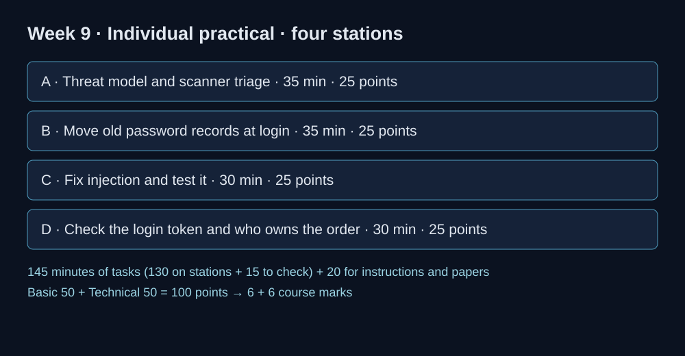

# Week 9 midterm practical — what you will do

**02005094 · Week 9 · individual work · Tuesday 29 December 2026, 09:05–11:50, our usual classroom · 165 minutes:** 10 minutes of instructions, 145 minutes on the four stations (suggested times below add up to 130, which leaves 15 to check), 10 minutes to collect papers.

**Paper exam, closed book.** Bring your student ID card and a pen (blue or black). No computer, phone, notes or AI. Each station gives you printed code, results or a short description; you write your answers on the paper.

**Points:** four stations × 25 points = 100 points, which count as 12% of your course grade. Only the four stations below are marked.

## Words you will see

| Word | Meaning |
| --- | --- |
| **Point** | A mark on this practical, out of 100. |
| **Positive test** | A normal, allowed request that must still work after your fix (for example, the owner reading their own order). |
| **Negative test** | A bad or attacking request that your fix must refuse (for example, another user reading that order). |
| **False positive** | A scanner warning that turns out not to be a real problem. |
| **Parameterized SQL** | Sending user input to the database as a separate value (`?`), never pasted into the SQL text. |
| **argv list** | Running a program as a list such as `["ping", "-c", "1", host]`, so no shell reads the input. |
| **JWT** | A signed login token. **sub** = which user, **aud** = which app it is for, **exp** = when it expires. |
| **Pinned algorithm** | The server accepts only the one signing method it expects (here HS256), and refuses unsigned tokens. |

## Station A — Threat model and scanner triage: 25 points, 35 minutes

**Revise:** Weeks 1 and 2 (and the Week 6 ownership check).

You get a short description of an app (browser → server → storage) and some review and scanner findings.

1. Draw the data flow and mark where the trust boundaries are.
2. Decide which finding is a real problem and which is probably a false positive, and how you would check it.
3. One scan failed with a tool error. Say clearly that this scan did not succeed; it is not a clean result.
4. Write the fix as code, plus one positive test and one negative test with the results you expect.

## Station B — Moving old password records: 25 points, 35 minutes

**Revise:** Week 3.

You get a printed login function that still has old, unsalted hashes. Write the line that replaces a user's old hash with an Argon2id hash when they log in with the correct password, and explain where it must go. Write three tests with their expected results:

1. A wrong password is refused, and the stored record does not change.
2. A correct password logs in, and the record is now Argon2id.
3. The next login with the same password still works.

Then explain why you cannot upgrade every old hash at once without the users' passwords.

## Station C — Stop injection: 25 points, 30 minutes

**Revise:** Week 4.

Write two functions by hand: a login query that uses parameterized SQL, and a ping helper that accepts one real IPv4 address and returns an argv list. Give:

- a normal login and a normal IPv4 address such as `127.0.0.1` that still work (positive tests);
- an SQL injection string that does not log in, and a host containing shell characters such as `;` or `|` that is refused before anything runs (negative tests).

## Station D — Check the token and who owns the object: 25 points, 30 minutes

**Revise:** Week 6.

Write the code that checks the JWT properly (pinned algorithm, and **sub**, **aud** and **exp** are all required), and the check that the order belongs to the logged-in user. Give the expected result for:

- the owner reading their own order (positive test);
- another user reading it (negative test);
- a broken or unsigned token (negative test).

## How each station is marked

Each station has **25 points**, split in two halves:

| Half | Points | What earns them |
| --- | ---: | --- |
| **Basic** | 12.5 | Correct finding or root cause 5 · explaining how it works and where the boundary is 5 · reading the evidence you are given and stating its limits 2.5 |
| **Technical** | 12.5 | Your own fix, written as code 5 · positive and negative tests with expected results 5 · reading a printed test output correctly 2.5 |

Four stations give Basic 50 + Technical 50 = 100 points. Your course mark is (Basic ÷ 50 × 6) + (Technical ÷ 50 × 6), so at most 12. You get partial marks for each part you show. Small syntax slips do not lose marks if the idea is clear.

Write your name and student ID on the first page. Papers are collected in the final 10 minutes; there is no extra writing time.
