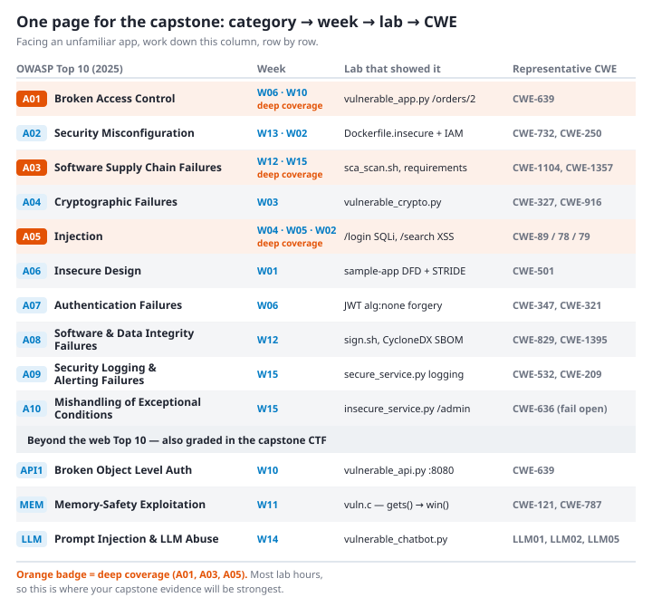

# Week 16 — Formative project checkpoint

**Class:** Tuesday 16 February 2027, 09:05–11:50 (150 minutes), in your existing project team of 2–3.

**Assessment:** Formative — a project checkpoint for feedback; no separate worksheet marks, no due date and no late penalty for this sheet.

> **Course:** Software Security (KOSEN69) · Week 16
> **Aligned to:** All prior weeks + OWASP Top 10 (2025) — https://owasp.org/Top10/2025/ ; CWE mapping required throughout.
> **Optional extra:** a practice scrimmage previewing Week 19 ([scrimmage.md](scrimmage.md)), plus cross-team peer review. The scrimmage gives no marks and needs no flags.

> ⚠️ **Ethics note:** This is a **project studio**, not an exploit lab. Demo your attack → root cause → fix **only** against your own term-project application (see `project/README.md` in the repo root) or the provided practice-CTF targets. The final team practical is in **Week 19**. Submit the project report/code and recorded video (at most 5 minutes) before Week 19; project clarification takes place in Weeks 16 and 20. This worksheet is formative and is not a thirteenth graded Lab.

---

## Part 1 — Student Information

| Name | Student ID | Date | Group |
|------|-----------|------|-------|
|      |           |      |       |

---

## Part 2 — Lecture Questions

Answer as a team (2–4 sentences each).

1. State your project's **top-3 risks** from your threat model and the STRIDE/attack category each falls under.
2. For your headline vulnerability, give its **CWE id** and **OWASP 2025** category, and one sentence on root cause.
3. What does your **SBOM** cover (declared, transitive and/or image components), how was it generated, what is absent, and what would you do if a listed dependency got a new CVE next week?
4. How is your build artifact **signed**, and how would a consumer verify the signature (and why does signing matter for supply-chain trust)?
5. Which **CI checks** from Week 15 (Semgrep / Trivy / Gitleaks) does your pipeline enforce, which configured findings or scanner errors make it fail, and what does a failing build look like?

---

## Part 3 — Project Checklist & Demo Rubric

> Bring the existing project deliverables. Use the 100-minute build/peer-review block to improve and test the project; peer teams can watch a preview of at most 5 minutes. Instructor clarification has a separate 30-minute window, without requiring a serial live presentation from every team.

### A) Deliverables checklist (bring all six)

| # | Deliverable | Done? | Evidence to show |
|---|-------------|:-----:|------------------|
| 1 | **Threat model** | ☐ | Data-flow diagram + trust boundaries; top risks ranked (STRIDE) |
| 2 | **Vulnerability report** | ☐ | Each finding mapped to **CWE + OWASP 2025**, with severity and PoC |
| 3 | **Fixed code** | ☐ | Before/after diff for each finding; root cause noted |
| 4 | **SBOM** | ☐ | Machine-readable CycloneDX, as required by the project, with explicit component scope and known omissions |
| 5 | **Signed artifact** | ☐ | Signature + the exact verification command a consumer runs |
| 6 | **CI pipeline** | ☐ | Security gate that fails on configured findings, detected secrets or check errors; link to a run |

### B) Optional 5-minute peer preview (inside the build/review block)

| Time | Segment | Evidence |
|---|---|---|
| 0:00–0:45 | Context | App purpose, threat model and selected boundary |
| 0:45–1:45 | Finding | Authorized reproduction and root cause |
| 1:45–3:30 | Fix and verify | Student patch; negative and legitimate positive control |
| 3:30–4:30 | Delivery | SBOM scope, trusted-signature verification, CI red/green result |
| 4:30–5:00 | Limits | Outstanding risk and next action |

This is feedback. The final recorded project video is also at most 5 minutes, submitted with the report by Sunday 28 February 2027, 23:59. Project marks follow only the existing project rubric.

### C) Peer-review rubric (score the team you review, 1–5 each)

| Criterion | 1 (weak) → 5 (strong) |
|-----------|------------------------|
| Threat model completeness | Missing boundaries → thorough, ranked, realistic |
| Vulnerability mapped to CWE/OWASP | Vague → precise id + accurate severity |
| Exploit clarity | Hand-wavy → clear, reproducible PoC |
| Remediation quality | Superficial → root-cause fix, re-tested |
| SBOM + signing | Absent → complete + verifiable |
| Pipeline / fail-closed | None → gate fails closed on HIGH/CRITICAL |
| Demo & Q&A | Unclear → confident, handles tough questions |

> Optional practice scrimmage: if your checklist is ready, pick one bounded task from [scrimmage.md](scrimmage.md). Record the root cause, your fix, one legitimate and one attack test, and which week's technique it used. No flags are needed; this previews the Week 19 final.

---

## Part 4 — Reflection (Lessons Learned)

1. **Lessons learned.** What surprised your team most while threat-modeling and fixing your own app?
2. **What you'd harden next.** Given more time, which control would you add first (e.g., least-privilege IAM, image hardening, output handling, fail-closed paths), and why?
3. **Week 19 takeaway.** Which topic (web, API, memory safety, supply chain, cloud or AI) feels hardest for your team, and what will you practise before Week 19?

---

## Formative feedback checklist (not course marks)

| Project rubric criterion | Existing project points (for reference) | What to demonstrate |
|-----------|:------:|-----------------------|
| Threat model quality & completeness | 20 | Complete DFD, trust boundaries, ranked risks (STRIDE) |
| Vulnerability findings | 25 | Reproducible findings with correct severity, CWE/OWASP mapping and impact |
| Remediation quality | 25 | Root-cause fixes with before/after and re-tests |
| Supply-chain hardening | 15 | SBOM scope, trusted-signature verification and provenance claims distinguished |
| CI pipeline | 10 | Security gate fails closed on the stated threshold; red/green run linked |
| Presentation & report clarity | 5 | Report and recorded video of at most 5 minutes explain the evidence and limits |

**Feedback only:** retain the checklist and peer comments in the project working folder. There are no separate Week 16 worksheet marks or late penalties. The project deadline is Sunday 28 February 2027, 23:59 on learn.zcr.ai/submit; the rubric is in the project guide.

---

## Evidence and integrity for the project checkpoint

Keep the actual patch, test output, commands and contribution notes. Use your own authorized project or the provided practice targets; do not disclose production credentials. No personalized flag, identity-stamped screenshot or external AI account is required for every checkpoint. Your instructor may ask your team short questions to check that the work is yours; this only clarifies the existing project marks, and one answer alone never means zero.

## Conventional / AIR-Sec practice (formative)

This week (Week 16) odd student IDs practise **Conventional** and even student IDs practise **AIR-Sec**; both are optional feedback. Conventional: answer the original Part 2 questions and Part 4 reflections above. AIR-Sec: audit a supplied or disclosed AI explanation against project evidence; correct it only where evidence warrants, explain the mechanism plainly, and propose a precise verification prompt. A correct AI answer can be accepted with verified evidence. These exercises are feedback, without separate 60/40 worksheet marks in Week 16. The complete prior exercise wording is retained in the historical reference worksheet in the course source.
