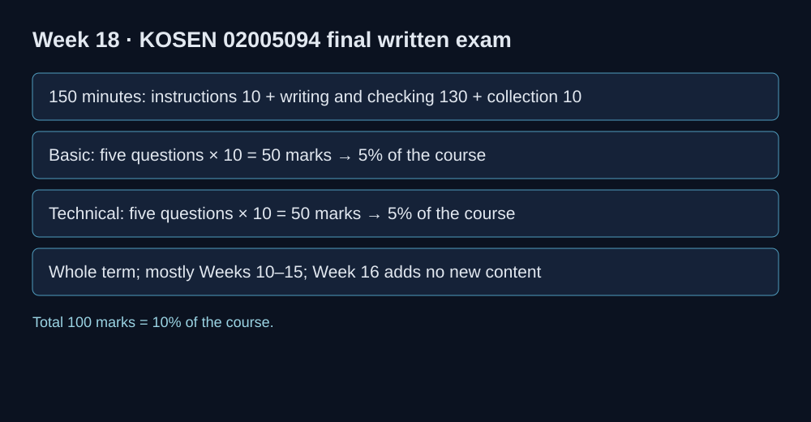

# Final written exam — practice paper

**Course: Software Security 2 (02005094) · Week 18 · 150-minute exam: 10 minutes instructions + 130 minutes writing and checking + 10 minutes collection.**

**100 marks: Basic 50 + Technical 50. Counts 10% of the course (5% Basic + 5% Technical).** Covers the whole term, mostly Weeks 10–15; Week 16 adds no new exam content.

Name: __________________ Student ID: ______________ Date: ___________

This practice paper shows the topics and the amount of work. The real exam paper is different and you receive it only on the day. Answer the ten questions below. Each is worth 10 marks; spend about 12 minutes on each (120 minutes), then use the last 10 minutes of the 130 to check your answers. The instruction and collection time is not extra writing time. Use only the information on the paper and the aids your instructor announces. Clear explanations of how an attack or fix works earn more marks than memorized ID numbers.

## 1. B1 · Basic — 10 marks, about 12 minutes

Define BOLA and mass assignment, and explain the difference between checking *who the caller is* (authentication) and deciding *whether they may use this object* (authorization). Give an example of a field a client may set when creating an account, and a privilege field it must not set.

## 2. B2 · Basic — 10 marks, about 12 minutes

Explain what canaries, ASLR, NX and PIE each make harder for an attacker. State one benefit and one limit of a memory-safe language, and explain why a ret2win offset that works on one build may not work on another.

## 3. B3 · Basic — 10 marks, about 12 minutes

Explain the difference between an SBOM, a vulnerability scan, a signature and a trusted signing identity. Explain why having a signature does not, on its own, prove SLSA compliance or that you should trust the signer.

## 4. B4 · Basic — 10 marks, about 12 minutes

Name three risks in a container that runs as root, has a password or key built into it, and uses an IAM policy with `*` wildcards. Explain what a local policy checker can show, and what can only be confirmed in the real cloud account or at run time.

## 5. B5 · Basic — 10 marks, about 12 minutes

Explain the difference between direct and indirect prompt injection, unsafe HTML output, and giving a tool too much privilege. Explain why telling the model "do not do X" is not a real permission check.

## 6. T1 · Technical — 10 marks, about 12 minutes

An API lets the caller alice read bob's orders, and accepts `is_admin` when an account is created. Write an owner/admin check and a list of allowed creation fields that leaves out privilege fields. For each control, give one request that should work and one that should be refused.

## 7. T2 · Technical — 10 marks, about 12 minutes

A service receives UTF-8 text from users. Explain the difference between counting bytes and counting Unicode characters (scalar values), show how to handle invalid input safely, and design one test with valid input and one with broken bytes. Explain one limit that still remains (for example, very large input).

## 8. T3 · Technical — 10 marks, about 12 minutes

A correctly signed file is checked with the wrong public key. Design a verification step that first checks the key is the trusted one, and only then accepts the signature result. Include three tests: valid signature with the trusted key, tampered file, and valid signature with the wrong key. State what an SBOM adds.

## 9. T4 · Technical — 10 marks, about 12 minutes

Design a least-privilege S3 policy that can read only `releases/*` in the bucket `course-artifacts` and list only that prefix. Keep `s3:GetObject` (on objects) and `s3:ListBucket` (on the bucket, with a prefix condition) separate. Give one allowed case and two denied cases, and explain the difference between reviewing the policy text and testing it in a live AWS account.

## 10. T5 · Technical — 10 marks, about 12 minutes

This question has two parts, 5 marks each (spend about 6 minutes on each).

**(a) AI output and tool, 5 marks.** An assistant that reads documents shows its reply as HTML and can call a privileged tool. Describe HTML-escaping the reply and a server-side permission check before the tool runs. Give one allowed and one refused example.

**(b) Deny on error, 5 marks.** A CI service catches login errors and then gives admin access. Describe denying access when an error happens, and logging that never records secrets. Give one allowed and one refused example.
