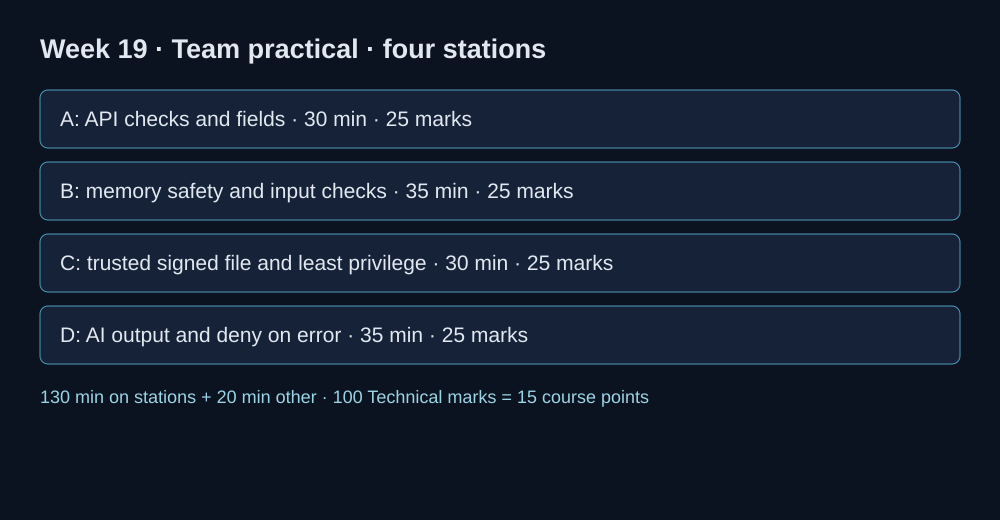

# Final team practical — the four stations

**02005094 · Week 19 · 150-minute exam (date and room in the official notice): 10 minutes instructions + 130 minutes on the stations + 10 minutes to collect papers.**

**Paper exam, closed book.** No computer, phone, notes or AI. Each station gives you printed code, results or a short description; you write your answers on the paper.

**100 marks, all Technical · counts 15% of the course · your existing project team of 2–3, one answer booklet per team.** Only the four stations below are required. Marks come from the fixed marking scheme at the bottom of this page.

**Splitting the work:** your team may split the stations between members, but every member must be able to explain any station if the instructor asks. Write on the first page who wrote which station.

**How to prepare:** redo the weekly student task that matches each station (listed under each station below), and practise writing the fixes by hand.

## Station A — Who may read what, and which fields a client may set: 25 marks, 30 minutes

**Practice:** Week 10 (plus Weeks 4–6).

Write the owner/admin check for reading orders, and a list of fields a client may set when creating an account. Give the expected result for the owner and an admin reading orders, another user being refused, and a privilege field such as `is_admin` being ignored or rejected. Explain why the lab's identity header is not real login.

## Station B — Memory safety and input checks: 25 marks, 35 minutes

**Practice:** Week 11.

You are given crash information from a C program; explain the unsafe copy and why a ret2win offset only works on that one build. Then write the Rust function that counts Unicode characters (not bytes), and give the expected output for a valid input and for invalid UTF-8. You do not write an exploit.

## Station C — Trusting a signed file, and least privilege: 25 marks, 30 minutes

**Practice:** Weeks 12 and 13.

Write the code that accepts a signature only if the public key's fingerprint is the trusted one, and give the expected result for a valid signature with the trusted key, a tampered file, and a valid signature with the wrong key. Then fix a small S3 policy so it can only read and list one folder, keeping object reading and bucket listing as separate decisions. Explain what a local check cannot prove about a real system.

## Station D — Untrusted AI output, and deny on error: 25 marks, 35 minutes

**Practice:** Weeks 14 and 15.

Write two things: remove the secret from the AI output and then HTML-escape it, and make the permission check deny access when the lookup throws an error, with a log line that never contains the token or the error text. Give the expected result for a normal request, the secret, script markup and the error case.

## Marking scheme

Each station (25 marks): root cause and trust boundary 5 + your fix, written as code 10 + one allowed and one refused example with expected results 7 + reading a printed test output and stating one limit 3 = 25. Four stations = 100 marks, all Technical. Course points = marks ÷ 100 × 15. Partial marks come from your evidence and reasoning. Small syntax slips do not lose marks if the idea is clear.

You may be shown the test output from someone else's fix and asked what it means.

Your project report, code and a video of at most 5 minutes are due **Sunday 28 February 2027, 23:59** (before this exam) and are marked separately (15% of the course). There are no project questions during the 130 minutes; ask them in Weeks 16 and 20. Each member's project mark is adjusted by peer contribution and can be at most 100 before it is converted to 15%.

Write every member's name, student ID and stations on the first page. Papers are collected in the final 10 minutes; there is no extra writing time.
